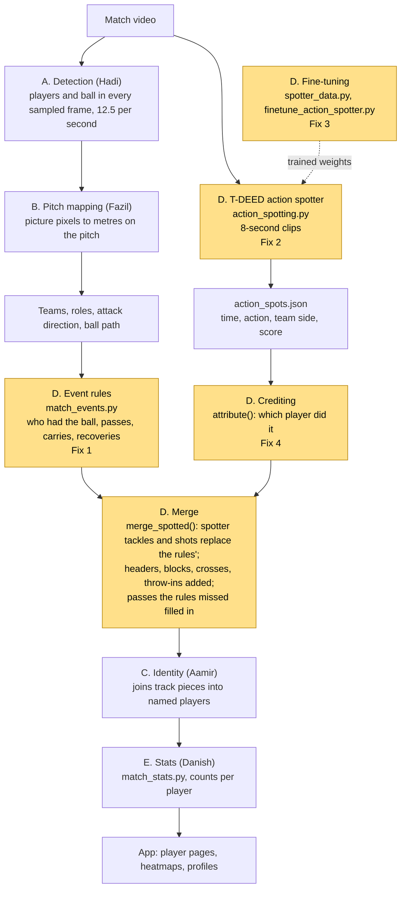
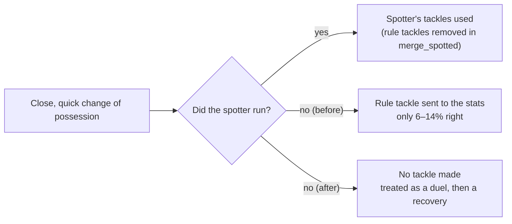
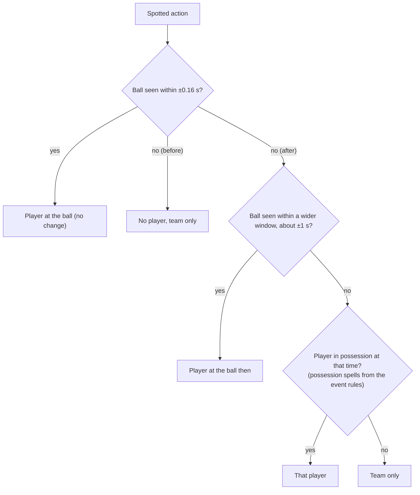

# PitchProfile, Group D (Events)

Owner: Hasif. This branch (`dev-hasif`) holds only the Group D files. The full project is on `main`.

**Status on 10 Nov:** 3 of the 4 improvements are coded, tested and pushed. Two runs are waiting on Hadi's PC, and the crediting fix is next. After that comes a final commit. Hadi then copies the commits into `main` and tests everything, and Group D is finished. The full list is in section 6.

## 1. What Group D does

Group D turns tracked players and the ball into match events, such as passes, carries, shots and tackles, and says which player did each one. Danish's stats (Group E) then count those events per player.

There are two parts.

**Event rules** (`match_events.py`). Hand-written rules that run on the player and ball positions. They work out who had the ball and when. The event comes from where the ball went next:

| What happens | Event |
|---|---|
| next touch is by a teammate | completed pass |
| next touch is by an opponent | intercepted pass or clearance, then a recovery |
| one player moves the ball 2 m or more | carry |

**T-DEED action spotter** (`action_spotting.py`). A trained video model. It watches the broadcast in 8-second clips and marks the moment of actions that positions alone cannot show: shots, tackles, blocks, headers, crosses and throw-ins. Each spotted action is then credited to a player.

**Fine-tuning** (`spotter_data.py`, `scripts/finetune_action_spotter.py`). Training starts from the published SoccerNet T-DEED model and continues on SoccerNet BAS and FOOTPASS games. FOOTPASS labels are rougher than the model's 12 classes. A FOOTPASS "Pass" could be a pass, a high pass or a free kick. The partial-label loss tells the model "it is one of these" instead of forcing a guess.

## 2. The whole pipeline, start to finish

Yellow boxes are Group D. "Fix 1" to "Fix 4" point to section 4.



In the code (`match_pipeline.analyse`), the order is:

| Order | Step | Where |
|---|---|---|
| 1 | Detection pass over the video | `match_analysis.detection_pass` |
| 2 | Spotter over the same video; writes `action_spots.json` | `match_pipeline.spot_actions` |
| 3 | Pitch mapping, teams, ball path | `match_pipeline.stages` |
| 4 | Event rules | `match_events.events` |
| 5 | Credit the spotted actions, then merge them with the rule events | `action_spotting.attribute`, `match_pipeline.merge_spotted` |
| 6 | Identity | `match_identity` |
| 7 | Stats, then the dataset the app reads | `match_stats.build`, `write_dataset` |

## 3. Before vs after at a glance

| Fix | Improvement | Before | After | Checked by | Status |
|---|---|---|---|---|---|
| 1 | Tackle rule leak | If the spotter did not run, the rules made tackles that were only 6–14% right, and they went into the stats | The rules no longer make tackles in the app | new test | Done, `f50f8ec` |
| 2 | Duplicate `available()` | Two copies; the second silently replaced the first | One copy, the one Python already used | new test | Done, `24b34ab` |
| 3 | Prove the partial-label loss | No evidence that the loss itself helped, only that the fine-tune did | One command trains it both ways and compares | tests and a dry run now; real numbers from Hadi's run | Code done, run waiting |
| 4 | Crediting the right player | Right player for only 34% of passes; about 1 in 4 spotted events get no player | Look wider in time, fall back to the player on the ball, fix the throw-in team | tests, plus before/after on Hadi's PC | Next |

## 4. Each improvement in detail

### Fix 1. Tackle rule leak (done, `f50f8ec`)

**The problem.** The rules saw a close, quick change of possession and called it a tackle: the ball changes team within 0.6 s and the two players are within 2.2 m. They also marked the other player as dispossessed. Against SoccerTrack ground truth, this was right only 6–14% of the time, so the team moved tackles over to the spotter.

The swap happened in `merge_spotted`, but that only runs when `action_spots.json` exists. With no spotter output, the bad tackles went straight into the stats. That happens when there is no GPU, the model is missing, or the spotter crashed.



| | Before | After |
|---|---|---|
| `match_events.events()` | always added `tackle` and `dispossessed` | only adds them when called with `tackle_rule=True` |
| default | none | `TACKLE_RULE = False` at the top of `match_events.py` |
| `evaluate_events_soccertrack.py` | measured the rule | still measures it (passes `tackle_rule=True`), so the 6–14% row in the evaluation still comes out |
| App with the spotter | spotter tackles | no change |
| App without the spotter | wrong rule tackles in the stats | no tackles |

**Validation.** A new test in `tests/test_match_events.py` has player B1 take the ball off A1. By default, no tackle is made and it is not counted as a pass, only as B1's recovery. With `tackle_rule=True`, the tackle and the dispossession are still found.

### Fix 2. Duplicate `available()` (done, `24b34ab`)

| | Before | After |
|---|---|---|
| `action_spotting.available()` | defined twice; Python keeps only the second. The first checked that the devkit folder exists, the second that the devkit's `model/model.py` exists | one copy, the one Python was already using |
| Effect on outputs | n/a | none |

**Why.** It looks like a bug when you read the file, and it is a likely Q&A question.

**Validation.** A new test in `tests/test_spot_actions.py` covers three cases:
- No devkit gives False.
- A devkit folder without its model code gives False.
- A checkpoint plus the model code gives True.

### Fix 3. Proving the partial-label loss (code done in `8da14ad` and `e62fa33`; run waiting)

**Why.** This loss is Group D's "novel training strategy" for the Model Development row of the rubric. The fine-tune raised FOOTPASS mAP from 0.478 to 0.604, but that could come from the extra training data alone. Only a run with the loss switched off shows what the loss adds.

**What the switch changes.** It changes only how FOOTPASS labels are taught. BAS labels are the same in both.

| FOOTPASS label | Partial labels (ours, default) | Normal labels (`--hard-labels`) |
|---|---|---|
| Pass | PASS, HIGH PASS or FREE KICK | PASS |
| Cross | CROSS or FREE KICK | CROSS |
| Shot | SHOT or FREE KICK | SHOT |
| Header | HEADER or SHOT | HEADER |
| Drive, Throw-in, Tackle, Block | one class each | the same one class |
| Frame with no label | background, OUT or GOAL | background only |

| | Before | After |
|---|---|---|
| `finetune_action_spotter.py` | partial labels only | `--hard-labels` trains with normal labels; it refuses to run without its own `--out-dir`, so it can never overwrite the adopted model |
| Running the comparison | by hand | `scripts/run_loss_ablation.py` trains both versions with the adopted run's settings (read from `evidence/action_spotter_finetune.json`), scores both on FOOTPASS val and BAS test, and writes `evidence/loss_ablation.json` |

The partial version is trained again as well, rather than reusing the adopted model. That way both versions run under exactly the same conditions, and the only difference is the loss.

**Results (to fill in after Hadi's run):**

| Model | FOOTPASS val mAP | BAS test mAP |
|---|---|---|
| Published, no fine-tune | 0.478 | 0.606 |
| Adopted fine-tune (partial labels) | 0.604 | 0.628 |
| Rerun, partial labels | waiting | waiting |
| Rerun, normal labels | waiting | waiting |

**How to read it.** Compare the two reruns:
- If partial labels are clearly higher, the loss works, and that is the claim for the slides.
- If the two are about equal, the gain came from the data, and we say that honestly.

**Validation now.** `tests/test_spotter_data.py` checks the label masks in both modes. `tests/test_loss_ablation.py` checks the commands the runner builds. The dry run was checked on the Mac. The real run takes about 7–8 hours on Hadi's 3090.

### Fix 4. Crediting the right player (next)

**Measured now** (`evaluate_identity_footpass.py`, table 12):

| Action | Spotter found it | Credited to the right player |
|---|---|---|
| Pass | 90% | 34% |
| Shot | 52% | 17.9% |
| Header | 64% | 9.3% |
| Throw-in | 68% | 6.2% |

The spotter finds most actions. The weak part is picking the player.

**How `attribute()` works now:**
1. Take the spotted team from the spotter's side output.
2. Look only 2 samples either side of the spot, which is about ±0.16 s at 12.5 per second.
3. If the ball is seen, credit the player of that team whose picture box holds the ball.
4. Otherwise, credit the nearest player of that team within 3 m on the pitch.
5. Otherwise, credit nobody; the event stays team-only.

The ball is small, blurred, in the air or hidden a lot of the time, so it is often not seen in that 0.3 s. That is the main reason about 1 in 4 spotted events get no player. Throw-ins also take their team from the spotter's own side output, which is weak.

**Planned change:**



| | Before | After (planned) |
|---|---|---|
| Ball not seen near the spot | no player | wider window, then the player in possession |
| Throw-in team | spotter's side output | the team that did not touch the ball last before it went out |
| `contacts()` in `match_events.py` | unused | reused for the fallback, or deleted |

**Validation plan.** Each new rule gets a unit test on the Mac. Hadi then runs `evaluate_identity_footpass.py` before and after; it needs no GPU. That gives a before/after version of the table above for the slides.

To build this, either Hadi shares the analysed output folders (no videos), or I write him a short script to run.

### Not ours: the Dispossessed count (Danish)

`match_stats.py` (lines 198 and 206) counts Dispossessed only from events with `source = rules`. When the spotter runs, `merge_spotted` replaces those with spotter events, so Dispossessed shows 0. Danish needs to fix this in Group E.

## 5. Validation we have

| What | How | Result |
|---|---|---|
| Group D unit tests | pytest on the Mac (command below) | 20 passed, 1 skipped (needs a GPU) |
| Spotter, FOOTPASS held-out games | mAP | 0.478 → 0.604 |
| Spotter, BAS test games | mAP | 0.606 → 0.628 |
| Spotter, passes and carries | AP | about 0.9 |
| Spotter, tackles | AP | 0.06–0.10 (weak) |
| Shots on held-out games | precision / recall | 0.68 / 0.74 |
| Event rules on SoccerTrack (true positions), passes | precision / recall | 0.69 / 0.70 |
| Passes per player against ground truth | correlation | r = 0.89 |
| Rule tackles on SoccerTrack | precision | 6–14% (the reason for fix 1) |
| Crediting | right player | pass 34%, shot 17.9%, header 9.3%, throw-in 6.2% |

Still to come: the loss comparison (fix 3) and crediting before/after (fix 4).

## 6. Steps to finish

| Step | What | Who | Status |
|---|---|---|---|
| 1 | Branch `dev-hasif` and a baseline commit of the Group D files as Hadi left them | Hasif | Done, `c084508` |
| 2 | Test setup on the Mac | Hasif | Done |
| 3 | Fix 2, duplicate `available()` | Hasif | Done, `24b34ab` |
| 4 | Fix 1, tackle rule leak | Hasif | Done, `f50f8ec` |
| 5 | Fix 3 code: label switch and runner | Hasif | Done, `8da14ad`, `e62fa33` |
| 6 | This README | Hasif | Done |
| 7 | Message Hadi (GPU run, sharing outputs, merge plan) and Danish (Dispossessed) | Hasif | To do |
| 8 | Overnight loss comparison; send back `evidence/loss_ablation.json` | Hadi's PC | Waiting |
| 9 | Fix 4 code and tests; deal with `contacts()` | Hasif | Next |
| 10 | Crediting before and after, no GPU | Hadi's PC | After step 9 |
| 11 | Put both results into this README (sections 4 and 5) | Hasif | After steps 8 and 10 |
| 12 | Final commit on `dev-hasif` and push | Hasif | End |
| 13 | Hadi copies the code commits into `main`, runs all tests and analyses one match in the app | Hadi | End |
| 14 | Group D section in `main`'s README with the final numbers | Hasif and Hadi | End |
| **Done** | **Group D code finished** | | |
| 15 | Slides, poster box, demo minute, Q&A prep, backup video | Hasif | Wed 18–Fri 20 Nov |

Week 13 submission is about 23–27 Nov. Confirm the date on xSITe.

## 7. Commands

**Tests on the Mac (no GPU):**

```zsh
cd PitchProfile
.venv/bin/python -m pytest -q tests/test_spot_actions.py tests/test_spotter_data.py tests/test_match_events.py tests/test_loss_ablation.py
```

**Step 8, the loss comparison on Hadi's PC.** It runs on a new branch, so `main` is untouched:

```
git fetch origin dev-hasif
git switch -c hasif-ablation main
git checkout origin/dev-hasif -- PitchProfile
cd PitchProfile
.\.venv\Scripts\python.exe scripts\run_loss_ablation.py --dry-run
.\.venv\Scripts\python.exe scripts\run_loss_ablation.py
```

The dry run only prints the commands. The real run takes about 7–8 hours, and the file to send back is `evidence/loss_ablation.json`.

**Step 13, merging into `main` on Hadi's PC.** Copy the code commits only, not the README commits; `main` keeps its own README. The commits keep Hasif as author.

```
git fetch origin dev-hasif
git switch main
git cherry-pick 24b34ab f50f8ec 8da14ad e62fa33 <fix 4 commits>
cd PitchProfile
.\.venv\Scripts\python.exe -m pytest -q
```

Then analyse one match in the app and check that the event counts look normal. If a cherry-pick conflicts, stop and tell Hasif.
