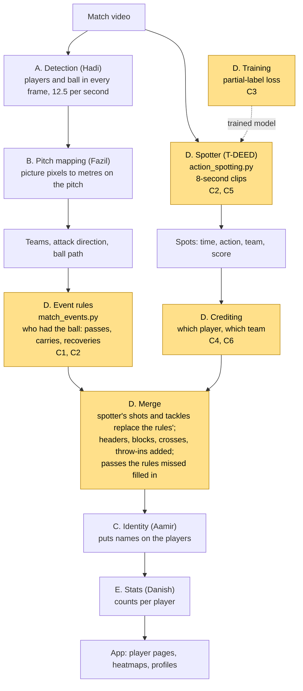
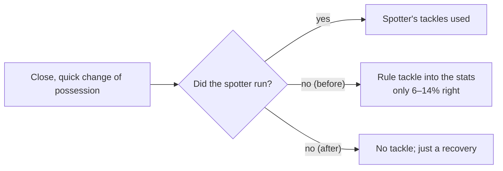
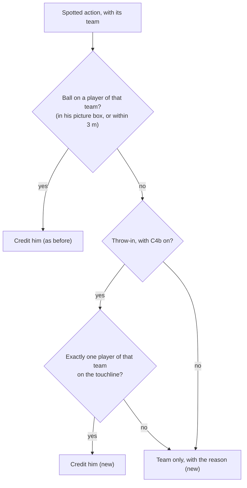

# PitchProfile, Group D (Events)

Owner: Hasif. This branch (`dev-hasif`) holds only the Group D files. The full project is on `main`.

**Where we are (10 Nov).** Six changes are coded, tested and pushed, in 11 commits. What is left is one round of runs on Hadi's PC to get the numbers. Then come the switch decisions, a final commit, and Hadi merging into `main`, and Group D is done. A practice merge onto the latest `main` applies cleanly, and every test still passes (section 6).

## 0. Words you need

| Word | Meaning |
|---|---|
| Event | Something that happened with the ball: pass, carry, shot, tackle, header, throw-in |
| Spotter | The video model (T-DEED). It watches the match and marks the moment each action happens. One mark is a "spot". |
| Crediting | Deciding *which player* did a spotted action |
| Track | One player's path through the video. "Right track" = the right player, even if we don't know his name. |
| Precision / recall | Precision: of what we said happened, how much was right. Recall: of what really happened, how much we found. |
| AP / mAP | One score from 0 to 1 for how well the spotter finds an action type (1 = perfect). mAP = the average over all action types. |
| Held-out games | Games the model never trained on. Used only for testing, so the score is fair. |
| Partial-label loss | Our training trick. A FOOTPASS "Pass" could be a pass, a high pass or a free kick. Instead of forcing one guess, we tell the model "any of these is fine". |
| Ablation | Training once with the trick and once without it, to prove the trick itself helped |
| Clip overlap | The spotter looks at 8-second clips. Each new clip starts 2 s after the last, so they overlap by three quarters and each frame is looked at 4 times. |
| Switch | A setting that is off by default. It is turned on only after Hadi's numbers show it helps. |
| Cherry-pick | Copying one commit from this branch onto `main` |

## 1. What Group D does

Group D answers "what happened, and who did it". It takes the players and ball found by Groups A and B, and turns them into events with a player's name on each. Danish (Group E) then counts the events into each player's stats.

There are two parts that work together.

**Event rules** (`match_events.py`) are rules we wrote by hand. They look at where the players and ball are, work out who had the ball, and read the event from where the ball goes next:

| What happens | Event |
|---|---|
| next touch is by a teammate | completed pass |
| next touch is by an opponent | intercepted pass or clearance, then a recovery |
| one player moves the ball 2 m or more | carry |

**The spotter** (`action_spotting.py`) is the trained video model. It catches what positions alone can't show: shots, tackles, blocks, headers, crosses and throw-ins. Each spot is then credited to a player.

**Training** (`spotter_data.py`, `scripts/finetune_action_spotter.py`). We started from the public SoccerNet model and trained it further on SoccerNet BAS and FOOTPASS games, using the partial-label loss for FOOTPASS's vague labels.

## 2. The whole pipeline, start to finish

Yellow boxes are Group D. "C1" to "C6" are the changes in section 4.



In the code (`match_pipeline.analyse`), the steps run in this order:
1. Detection on the video.
2. Spotter on the same video.
3. Pitch mapping and teams.
4. Event rules.
5. Crediting and merge.
6. Identity.
7. Stats.
8. Saved for the app.

## 3. The six changes at a glance

Honest labels: not every change is an improvement. Some fix bugs, some clean up, and some only measure or explain.

| # | Change | Type | Before | After | In the app | Status |
|---|---|---|---|---|---|---|
| C1 | Tackle leak | bug fix | If the spotter didn't run, a tackle rule that is only 6–14% right fed the stats | That rule never feeds the app | on | done |
| C2 | Tidy-ups | clean-up | One function written twice; one function nobody used | Both cleaned up; nothing behaves differently | on | done |
| C3 | Training comparison | experiment | No proof the partial-label loss itself helped | One command trains with and without it and compares | n/a | needs Hadi's overnight run |
| C4a | Why no player | diagnostic | 1 in 4 spotted passes and carries get no player, with no record of why | Every uncredited action says why | on | done; Hadi counts the reasons |
| C4b | Throw-ins by the touchline | possible improvement | Throw-ins credited worst (6.2% right player) | The one teammate on the touchline gets it | **switch, off** | Hadi measures |
| C5a | Read the video ahead | speed-up | Video reading and the model took turns | They run at the same time; results identical | on | Hadi times it |
| C5b | Half clip overlap | speed-up | Each frame looked at 4 times | 2 times: about half the model's work | **switch, off** | Hadi checks speed and accuracy |
| C6 | Throw-in team from the last touch | possible improvement | Throw-in team from the spotter's guess | The team that did not touch the ball last | **switch, off** | Hadi measures |

## 4. Each change in detail

### C1. Bad tackles leaking into the stats (bug fix, done)

**The problem.** The rules used to call a quick, close change of possession a "tackle": the ball changes team within 0.6 s with the players within 2.2 m. Checked against real labels, that was right only 6–14% of the time, so the team switched tackles over to the spotter. But the switch-over only happened when the spotter ran. If it didn't (no GPU, model missing, crash), the bad rule tackles went straight into the stats.



| | Before | After |
|---|---|---|
| Rule tackles in the app | yes, whenever the spotter didn't run | never (`TACKLE_RULE = False`) |
| Measuring the rule | `evaluate_events_soccertrack.py` | still works; it switches the rule on just for the measurement |
| App when the spotter ran | spotter tackles | no change |

**Tested by** a new test: player B1 takes the ball off A1. By default there's no tackle, and it doesn't count as a pass either. With the rule switched on, the tackle is still found.

### C2. Tidy-ups (clean-up, done)

| | Before | After | Why it matters |
|---|---|---|---|
| `available()` in `action_spotting.py` | written twice; Python silently used only the second | one copy, the one that was in use | Looks like a bug in a code review, and a likely Q&A question |
| `contacts()` in `match_events.py` | 46 lines nobody called, with a comment saying it credits spotted actions (not true) | removed; its one useful note kept: classifying tackles from ball contacts was tried and rejected | Dead code with a wrong comment confuses anyone reading it |

Nothing behaves differently. **Tested by** a new test that checks `available()` in three cases, and by all tests still passing after the removal.

### C3. Proving the training trick works (experiment, needs Hadi's overnight run)

**Why it matters.** The "Model Development: Excellent" row of the rubric asks for a "novel training strategy (loss functions…)", and the partial-label loss is ours. Fine-tuning raised FOOTPASS mAP from 0.478 to 0.604. But that gain could come just from the extra games, not from the trick. The only way to know is to train again *without* the trick and compare.

**What the switch changes.** It changes only how FOOTPASS labels are taught:

| FOOTPASS label | With the trick (ours) | Without (`--hard-labels`) |
|---|---|---|
| Pass | PASS, HIGH PASS or FREE KICK | PASS |
| Cross | CROSS or FREE KICK | CROSS |
| Shot | SHOT or FREE KICK | SHOT |
| Header | HEADER or SHOT | HEADER |
| Frame with no label | nothing, OUT or GOAL | nothing |

`scripts/run_loss_ablation.py` trains both versions with the exact settings of our real model, scores both on held-out games, and writes one table to `evidence/loss_ablation.json`. Both versions are trained fresh, so the only difference between them is the trick. It can never overwrite our real model.

**Result table (filled in after Hadi's run):**

| Model | FOOTPASS mAP | BAS mAP |
|---|---|---|
| Public model, no training | 0.478 | 0.606 |
| Our model (with the trick) | 0.604 | 0.628 |
| Retrained with the trick | waiting | waiting |
| Retrained without the trick | waiting | waiting |

**How to read it.** Compare the two "retrained" rows:
- With the trick ahead by a few hundredths on both sets: the trick works, and that is the claim for the slides.
- Under about 0.01 apart: too close to call with one run each. We say the gain came mostly from the extra data.

### C4. Crediting the right player (C4a diagnostic, done; C4b switch, Hadi measures)

**The problem.** The spotter finds most actions, but picking the player is weak:

| Action | Found | Right named player |
|---|---|---|
| Pass | 90% | 34% |
| Shot | 52% | 17.9% |
| Header | 64% | 9.3% |
| Throw-in | 68% | 6.2% |

Even with perfect names, only 59% of passes land on the right player, and about 1 in 4 spotted passes and carries get no player at all.

**What we did not do, and why.** Hadi tested a wider time window, looser boxes and falling back on the player in possession in September (`DETECTION_RESEARCH.md`, "What limits it now"). Each gained only 1–3 points and lost about as much precision. His conclusion: better ball detection is what would fix it.

**C4a. Every uncredited action now says why:**

| Reason | Meaning | Share of uncredited passes and carries (Hadi, Sept) |
|---|---|---|
| `no ball` | ball not found near that moment | 38% |
| `ball away from players` | ball found, but not on any player of that team | 36% |
| `team not on screen` | no player of that team visible | 22% |
| `no team` | the attack direction is unknown, so "left team" can't be matched to a team | rest |

`scripts/credit_reasons.py` adds these up per action type, with no GPU.

**C4b. Throw-ins by the touchline (switch, off).** At a throw-in, the ball is above the thrower's head, so its spot on the pitch lands metres away. So crediting by the ball fails. The thrower himself is easy to find: he stands on the touchline.



It credits only when exactly one player of that team stands within 1.5 m inside or 3 m behind a touchline. It only fills gaps: a throw-in already credited from the ball keeps its player.

### C5. A faster spotter (C5a on, C5b switch)

**Why it matters.** The "Model Deployment: Excellent" row asks for "optimized models". The spotter takes about 4.5 minutes per half on Hadi's 3090.

**C5a. Read the video ahead (on).** Before, the code read some frames, then waited while the GPU worked, then read more. Now a background thread keeps reading up to 256 frames ahead (about 270 MB of memory), so the two run at the same time. The frames and their order are exactly the same, so the results are identical. This was checked on the Mac by running the old code and the new code on the same test video with a stand-in model: identical scores, identical spots, identical progress messages.

**C5b. Half the clip overlap (switch, off).** Each frame is now looked at 2 times instead of 4, which is about half the model's work. This can change the scores slightly, so it stays off until Hadi checks accuracy on the held-out games.

| | Before | C5a (on) | C5a + C5b (switch) |
|---|---|---|---|
| Video reading and model | take turns | at the same time | at the same time |
| Times each frame is looked at | 4 | 4 | 2 |
| Results | n/a | identical | slightly different, measured |
| Time per half | about 4.5 min | waiting | waiting |

How much faster depends on how much of the 4.5 minutes is reading the video. One timing run on Hadi's PC tells us.

### C6. Throw-in team from the last touch (switch, off)

By the laws of the game, the throw goes to the team that did **not** touch the ball last. With C6, a throw-in's team is the opposite of the last confident touch before it, otherwise the spotter's own guess. The ball is often out of play for 10–30 s before the throw, so the look-back is 30 s (the tackle rule uses 4 s). `evaluate_spotter_labelled.py` now reports throw-in team accuracy for 10, 20 and 30 s look-backs, from Hadi's saved spotter output.

### Not ours: Dispossessed always shows 0 (Danish)

`match_stats.py` lines 198 and 206 count Dispossessed only from the rules. The rules stopped making those events with C1, and the spotter's own Dispossessed events were never counted. So it now shows 0 in every case; before C1, it was already 0 whenever the spotter ran. Danish has two choices:
- count the spotter's events by dropping `& rules` on those two lines, knowing they are as rough as tackles;
- hide the stat.

## 5. Other ideas, and why they are not in

| Idea | Verdict | Why |
|---|---|---|
| Wider window, looser boxes, possession fallback for crediting | skip | Hadi tested them in Sept: +1–3 points each at the same loss of precision |
| Flip trick (also run the video mirrored, average) | skip | Doubles the spotter's time for an unsure gain, against the speed-up |
| Headers: no credit from the ball's pitch position | skip | Could go either way; not worth a Q&A risk |
| Better tackle detection | skip | Already tried: a tackle-weighted training run moved tackle AP only from 0.06 to 0.08. The public model learned from just 34 tackles. |
| Averaging the public and our model; longer training | not now | More GPU time for an unsure gain |
| A model that credits players directly (SoccerNet 2026 task) | too big | The real fix for crediting, but a new model and new training, not doable in 2 weeks |
| Better ball detection | Group A | The real limit on crediting |
| Cloud deployment | team decision | Needed for Deployment "Excellent"; C5 is the optimised-model half of it |
| Dispossessed always 0 | Danish | His file, one-line change (above) |

## 6. What we have checked

| Check | Result |
|---|---|
| Group D tests on the Mac | 41 passed, 1 skipped (needs a GPU) |
| Whole project's tests on the Mac | 158 passed. The 4 that fail need an NVIDIA GPU or Hadi's data, and failed the same way before these changes. |
| Practice merge onto the latest `main` | All 11 code commits apply with no conflicts; same test results; the app's modules load |
| Defaults after the merge | read-ahead on; half overlap, both throw-in rules and the old tackle rule off |
| C5a, old code vs new code on a test video | identical scores, spots and progress messages |
| Hadi's new command, run with stand-ins on the Mac | works end to end: timing, both accuracy runs, comparison table |
| Spotter on held-out games | mAP 0.478 → 0.604 (FOOTPASS), 0.606 → 0.628 (BAS) |
| Spotter, passes and carries | AP about 0.9 |
| Spotter, tackles | AP 0.06–0.10 (weak; data limit) |
| Shots on held-out games | precision 0.68, recall 0.74 |
| Event rules with perfect positions (SoccerTrack) | passes: precision 0.69, recall 0.70 |
| Passes per player against the true counts | correlation r = 0.89 |
| Still to come | C3 table, C4 reasons and throw-in numbers, C5 speed and accuracy, C6 throw-in team, all from Hadi's runs |

## 7. Steps to finish

| Step | What | Who | Status |
|---|---|---|---|
| 1 | Branch, baseline, C1–C6 coded and tested | Hasif | Done |
| 2 | Practice merge onto `main` | Hasif | Done: clean |
| 3 | Message Hadi (section 8) and Danish (Dispossessed) | Hasif | **To do** |
| 4 | Hadi makes branch `hasif-groupd` with the 11 code commits and runs the tests | Hadi | Waiting |
| 5 | Short checks, no GPU: crediting reasons and C4b | Hadi's PC | Waiting |
| 6 | Spotter check, about 30 min of GPU: C5 speed and accuracy, C6 | Hadi's PC | Waiting |
| 7 | Overnight: training comparison (C3) | Hadi's PC | Waiting |
| 8 | Fill the result tables; switch on whatever won (one line each) | Hasif | After 5–7 |
| 9 | Final commit and push | Hasif | After 8 |
| 10 | Hadi cherry-picks the final commit(s), merges `hasif-groupd` into `main`, runs all tests and one match in the app | Hadi | End |
| **Done** | **Group D code finished** | | |
| 11 | Slides, poster box, demo minute, Q&A, backup video | Hasif | 18–20 Nov |

Week 13 submission is about 23–27 Nov; check the date on xSITe.

## 8. Commands

**Tests on the Mac (no GPU):**

```zsh
cd PitchProfile
.venv/bin/python -m pytest -q tests/test_evaluate_spotter.py tests/test_spotter_speed.py tests/test_spot_credit.py tests/test_spot_actions.py tests/test_spotter_data.py tests/test_match_events.py tests/test_loss_ablation.py
```

**On Hadi's PC, steps 4–7.** He takes the code commits only, not the README ones, because `main` keeps its own README. The short checks go first and the overnight training goes last, with nothing else on the GPU while timing:

```
git fetch origin
git switch -c hasif-groupd origin/main
git cherry-pick 24b34ab f50f8ec 8da14ad e62fa33 5f956d2 dc4f878 cbc0c1a b26e725 3af4de3 8ecef46 35b4036
cd PitchProfile
.\.venv\Scripts\python.exe -m pytest -q
.\.venv\Scripts\python.exe scripts\credit_reasons.py --footpass
.\.venv\Scripts\python.exe scripts\measure_shot_credit.py throwinline
.\.venv\Scripts\python.exe scripts\measure_shot_credit.py current
.\.venv\Scripts\python.exe scripts\check_spotter_changes.py
.\.venv\Scripts\python.exe scripts\run_loss_ablation.py --dry-run
.\.venv\Scripts\python.exe scripts\run_loss_ablation.py
```

| Command | Takes | Sends back | Decides |
|---|---|---|---|
| `credit_reasons.py --footpass` | minutes, no GPU | `evidence/credit_reasons.json` | C4a numbers |
| `measure_shot_credit.py throwinline`, then `current` | no GPU; `current` must run second, as it puts the data back | `evidence/identity_footpass_variant_throwinline.json` and `..._current.json` | C4b: on if throw-ins credited to the right player go up and the share right when credited does not drop |
| `check_spotter_changes.py` | about 30 min, GPU | `evidence/spotter_changes.json` | C5a: the score change must be 0 (or below 0.001). C5b: on if mean AP moves less than about 0.005 on both sets, otherwise the team decides. C6: on if a look-back beats the spotter's own throw-in team on both sets. |
| `run_loss_ablation.py` | about 7–8 h, GPU (leave overnight) | `evidence/loss_ablation.json` | C3 result |

**Step 10, the final merge on Hadi's PC.** He first cherry-picks any final code commit (the switches turned on), then:

```
git switch main
git merge hasif-groupd
cd PitchProfile
.\.venv\Scripts\python.exe -m pytest -q
```

Then he analyses one match in the app and checks that the event counts look normal. The commits keep Hasif as author.

## 9. Commits on this branch

| Commit | What |
|---|---|
| `c084508` | Baseline: the Group D files as they were on 5 Nov |
| `24b34ab` | C2: remove the duplicate `available()` |
| `f50f8ec` | C1: keep the rejected tackle rule out of the stats |
| `8da14ad` | C3: switch to train without the trick |
| `e62fa33` | C3: one-command training comparison |
| `5f956d2` | C2: remove the unused `contacts()` |
| `dc4f878` | C4a: record why a spotted action has no player |
| `cbc0c1a` | C4b: throw-in touchline rule, off until measured |
| `b26e725` | C5a: read the video ahead while the spotter runs |
| `3af4de3` | C5b: half clip overlap, off until measured |
| `8ecef46` | C6: throw-in team from the last touch, off until measured |
| `35b4036` | C5, C6: one command to time and check them (`check_spotter_changes.py`) |
| README commits | These notes (not copied to `main`) |
