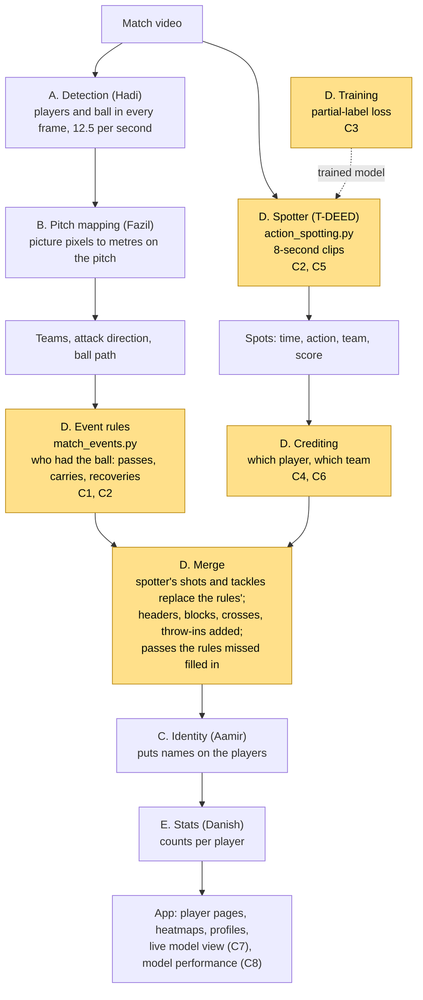
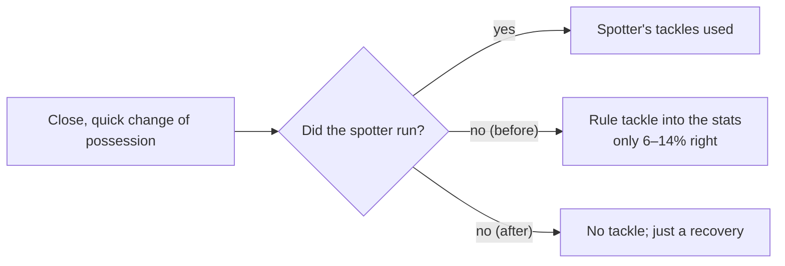
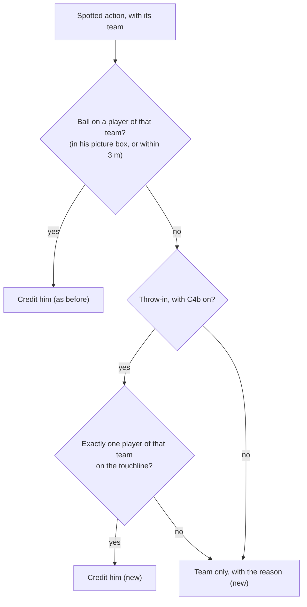

# PitchProfile, Group D (Events)

Owner: Hasif. This branch (`dev-hasif`) holds only the Group D files. The full project is on `main`.

**Where we are (18 Nov).** All nine changes are done and measured. On 17 Nov Hadi put the 16 code commits onto `main` as branch `hasif-groupd` (no conflicts), ran every check on his RTX 3090, and checked both new pages on the Chelsea v Manchester United demo match. In short:
- Read-ahead (C5a) stays on: the spotter is 1.45 times faster, with identical scores.
- The training trick (C3) gave no gain: training without it did as well or better. Our model's gain over the public one came from fine-tuning on more games.
- The touchline throw-in rule (C4b) named more throw-ins right but got more of them wrong, and the last-touch throw-in team (C6) was less accurate than the spotter's own call, so both stay off. Half overlap (C5b) is 2.4 times faster but moves the scores both ways, so it stays off too.
- Against our own labelled clip (C9), the app finds 61% of the actions and gives 89% of those the right team, but names the right player for only 1 of 17.

Two last code commits remain for Hadi to take before he merges into `main`: one makes a test pass on Windows, and the other words the C3 verdict plainly (section 8).

**Feedback of 12 Nov, and where it went:**

| Prof | Asked for | Answer |
|---|---|---|
| BJ | A live view: click a player, see which models are active and what each one called an action | C7 |
| BJ | Comparisons across model versions, and overall performance shown in the app | C8 |
| Panicker | Labelling players' actions and who the players are counts as curating our own dataset | C9 |
| Panicker | Accuracy need not be high; show understanding and what we would do with more time | C8 shows the weak points honestly; section 5 lists the next steps |

## 0. Words you need

| Word | Meaning |
|---|---|
| Event | Something that happened with the ball: pass, carry, shot, tackle, header, throw-in |
| Spotter | The video model (T-DEED). It watches the match and marks the moment each action happens. One mark is a "spot". |
| Crediting | Deciding *which player* did a spotted action |
| Track | One player's path through the video. "Right track" = the right player, even if we don't know his name. |
| Precision / recall | Precision: of what we said happened, how much was right. Recall: of what really happened, how much we found. |
| AP / mAP | One score from 0 to 1 for how well the spotter finds an action type (1 = perfect). mAP = the average over all action types. |
| Held-out games | Games the model never trained on. Used only for testing, so the score is fair. |
| Partial-label loss | Our training trick. A FOOTPASS "Pass" could be a pass, a high pass or a free kick. Instead of forcing one guess, we tell the model "any of these is fine". |
| Ablation | Training once with the trick and once without it, to test whether the trick itself helped |
| Clip overlap | The spotter looks at 8-second clips. Each new clip starts 2 s after the last, so they overlap by three quarters and each frame is looked at 4 times. |
| Switch | A setting that is off by default. It is turned on only after Hadi's numbers show it helps. |
| Cherry-pick | Copying one commit from this branch onto `main` |
| Live model view | The panel under the match video that shows, for the moment on screen, which models ran and what they found (C7) |
| Model performance page | The app page with every measured score, each model version side by side, and each change before and after (C8) |
| Own labels | Actions we labelled ourselves in one clip of the demo match, to score the app against (C9) |
| Hooks | Four lines in `main`'s `app.py` and `index.html` that connect the two new pages to the app |

## 1. What Group D does

Group D answers "what happened, and who did it". It takes the players and ball found by Groups A and B, and turns them into events with a player's name on each. Danish (Group E) then counts the events into each player's stats.

There are two parts that work together.

**Event rules** (`match_events.py`) are rules we wrote by hand. They look at where the players and ball are, work out who had the ball, and read the event from where the ball goes next:

| What happens | Event |
|---|---|
| next touch is by a teammate | completed pass |
| next touch is by an opponent | intercepted pass or clearance, then a recovery |
| one player moves the ball 2 m or more | carry |

**The spotter** (`action_spotting.py`) is the trained video model. It catches what positions alone can't show: shots, tackles, blocks, headers, crosses and throw-ins. Each spot is then credited to a player.

**Training** (`spotter_data.py`, `scripts/finetune_action_spotter.py`). We started from the public SoccerNet model and trained it further on SoccerNet BAS and FOOTPASS games, using the partial-label loss for FOOTPASS's vague labels.

## 2. The whole pipeline, start to finish

Yellow boxes are Group D. "C1" to "C6" are the changes in section 4.



In the code (`match_pipeline.analyse`), the steps run in this order:
1. Detection on the video.
2. Spotter on the same video.
3. Pitch mapping and teams.
4. Event rules.
5. Crediting and merge.
6. Identity.
7. Stats.
8. Saved for the app.

## 3. The changes at a glance

Honest labels: not every change is an improvement. Some fix bugs, some clean up, and some only measure or explain.

| # | Change | Type | Before | After | In the app | Status |
|---|---|---|---|---|---|---|
| C1 | Tackle leak | bug fix | If the spotter didn't run, a tackle rule that is only 6–14% right fed the stats | That rule never feeds the app | on | done |
| C2 | Tidy-ups | clean-up | One function written twice; one function nobody used | Both cleaned up; nothing behaves differently | on | done |
| C3 | Training comparison | experiment | No proof the partial-label loss itself helped | One command trains with and without it and compares | n/a | measured: no gain from the trick |
| C4a | Why no player | diagnostic | 1 in 4 spotted passes and carries get no player, with no record of why | Every uncredited action says why | on | done; measured |
| C4b | Throw-ins by the touchline | possible improvement | Throw-ins credited worst (6.2% right player) | The one teammate on the touchline gets it | **switch, off** | measured: leave off |
| C5a | Read the video ahead | speed-up | Video reading and the model took turns | They run at the same time; results identical | on | measured: 1.45 times faster, identical results |
| C5b | Half clip overlap | speed-up | Each frame looked at 4 times | 2 times: about half the model's work | **switch, off** | measured: 2.4 times faster, scores move both ways; off |
| C6 | Throw-in team from the last touch | possible improvement | Throw-in team from the spotter's guess | The team that did not touch the ball last | **switch, off** | measured: leave off |
| C7 | Live model view | new feature (feedback) | Nothing showed which model made an event, or why it got no player | Under the video: each event near the playhead with its model, score and how the player was picked or why not | on, once the hooks are in | done; checked on the demo match |
| C8 | Model performance page | new feature (feedback) | Scores only in report files on Hadi's PC | One page: model versions side by side, each action, crediting, speed, own labels, C1–C6 before and after | on, once the hooks are in | done; filled with Hadi's runs |
| C9 | Our own labelled clip | dataset (feedback) | Only public labels | 10 minutes of the demo match labelled by us (31 actions), and the app scored against it | n/a | done: 61% found, right player 1 of 17 |

## 4. Each change in detail

### C1. Bad tackles leaking into the stats (bug fix, done)

**The problem.** The rules used to call a quick, close change of possession a "tackle": the ball changes team within 0.6 s with the players within 2.2 m. Checked against real labels, that was right only 6–14% of the time, so the team switched tackles over to the spotter. But the switch-over only happened when the spotter ran. If it didn't (no GPU, model missing, crash), the bad rule tackles went straight into the stats.



| | Before | After |
|---|---|---|
| Rule tackles in the app | yes, whenever the spotter didn't run | never (`TACKLE_RULE = False`) |
| Measuring the rule | `evaluate_events_soccertrack.py` | still works; it switches the rule on just for the measurement |
| App when the spotter ran | spotter tackles | no change |

**Tested by** a new test: player B1 takes the ball off A1. By default there's no tackle, and it doesn't count as a pass either. With the rule switched on, the tackle is still found.

### C2. Tidy-ups (clean-up, done)

| | Before | After | Why it matters |
|---|---|---|---|
| `available()` in `action_spotting.py` | written twice; Python silently used only the second | one copy, the one that was in use | Looks like a bug in a code review, and a likely Q&A question |
| `contacts()` in `match_events.py` | 46 lines nobody called, with a comment saying it credits spotted actions (not true) | removed; its one useful note kept: classifying tackles from ball contacts was tried and rejected | Dead code with a wrong comment confuses anyone reading it |

Nothing behaves differently. **Tested by** a new test that checks `available()` in three cases, and by all tests still passing after the removal.

### C3. Testing the training trick (experiment, measured: no gain)

**Why it matters.** The "Model Development: Excellent" row of the rubric asks for a "novel training strategy (loss functions…)", and the partial-label loss is ours. Fine-tuning raised FOOTPASS mAP from 0.478 to 0.604. But that gain could come just from the extra games, not from the trick. The only way to know is to train again *without* the trick and compare.

**What the switch changes.** It changes only how FOOTPASS labels are taught:

| FOOTPASS label | With the trick (ours) | Without (`--hard-labels`) |
|---|---|---|
| Pass | PASS, HIGH PASS or FREE KICK | PASS |
| Cross | CROSS or FREE KICK | CROSS |
| Shot | SHOT or FREE KICK | SHOT |
| Header | HEADER or SHOT | HEADER |
| Frame with no label | nothing, OUT or GOAL | nothing |

`scripts/run_loss_ablation.py` trains both versions with the exact settings of our real model, scores both on held-out games, and writes one table to `evidence/loss_ablation.json`. Both versions are trained fresh, so the only difference between them is the trick. It can never overwrite our real model.

**Result (Hadi's run, 17 Nov):**

| Model | FOOTPASS mAP | BAS mAP |
|---|---|---|
| Public model, no training | 0.478 | 0.606 |
| Our model (with the trick) | 0.604 | 0.628 |
| Retrained with the trick | 0.597 | 0.645 |
| Retrained without the trick | 0.628 | 0.636 |

**How to read it.** Compare the two "retrained" rows. The rule set before the run: the trick works only if it is ahead by about 0.01 or more on both sets, and gaps under 0.01 are too close to call with one run each. Retraining with the trick, the same training as our real model, landed 0.007 from it on FOOTPASS (0.597 against 0.604) and 0.017 on BAS (0.645 against 0.628). That is how far two runs of the same training can differ.

**What it shows.** No gain from the trick. Without it, FOOTPASS is 0.031 higher; with it, BAS is 0.009 higher, which is inside the noise. Per action on FOOTPASS, plain labels did better on crosses (0.763 against 0.665), shots (0.664 against 0.587) and headers (0.668 against 0.633), and the trick was ahead on no action by more than 0.003. The trick helped only where it was aimed: on BAS, in the classes FOOTPASS has no label for, high passes (0.859 against 0.813) and balls going out (0.525 against 0.478). So our model's gain over the public one (0.478 to 0.604) came from fine-tuning on more games, not from the loss.

**What we do with it.** Our real model stays in the app. Every other number here was measured with it, and swapping models a week before the demo would mean measuring everything again. The plain-label model scored 0.024 higher on FOOTPASS and about the same on BAS, so it is the first thing to try with more time.

### C4. Crediting the right player (C4a diagnostic, done; C4b switch, measured: off)

**The problem.** The spotter finds most actions, but picking the player is weak:

| Action | Found | Right named player |
|---|---|---|
| Pass | 90% | 34% |
| Shot | 52% | 17.9% |
| Header | 64% | 9.3% |
| Throw-in | 68% | 6.2% |

Even with perfect names, only 59% of passes land on the right player, and about 1 in 4 spotted passes and carries get no player at all.

**What we did not do, and why.** Hadi tested a wider time window, looser boxes and falling back on the player in possession in September (`DETECTION_RESEARCH.md`, "What limits it now"). Each gained only 1–3 points and lost about as much precision. His conclusion: better ball detection is what would fix it.

**C4a. Every uncredited action now says why:**

| Reason | Meaning | Uncredited passes | Uncredited carries |
|---|---|---|---|
| `no ball` | ball not found near that moment | 34% | 34% |
| `ball away from players` | ball found, but not on any player of that team | 40% | 46% |
| `team not on screen` | no player of that team visible | 27% | 20% |
| `no team` | the attack direction is unknown, so "left team" can't be matched to a team | 0% | 0% |

`scripts/credit_reasons.py` adds these up per action type, with no GPU. Measured on 17 Nov over 6 analysed halves: 30% of spotted passes and 32% of carries get no player. Throw-ins are worst: 84% get no player, mostly because the throwing team is off screen (38% of throw-in spots) or the ball is not seen (28%).

**C4b. Throw-ins by the touchline (switch, off).** At a throw-in, the ball is above the thrower's head, so its spot on the pitch lands metres away. So crediting by the ball fails. The thrower himself is easy to find: he stands on the touchline.



It credits only when exactly one player of that team stands within 1.5 m inside or 3 m behind a touchline. It only fills gaps: a throw-in already credited from the ball keeps its player.

**Result (17 Nov): leave off.** On FOOTPASS held-out games, throw-ins credited to the right player rose from 6.2% to 10.3%, but the share right when credited fell from 67% to 56%. The rule credits twice as many throw-ins (16% to 32% of spots across the 6 halves) and gets more of them wrong. The rule set before the run asked for both to improve, so it stays off.

### C5. A faster spotter (C5a on; C5b switch, off)

**Why it matters.** The "Model Deployment: Excellent" row asks for "optimized models". Timed on Hadi's 3090 (5 minutes of Chelsea v Burnley, scaled to a 45-minute half), the spotter took 3.2 minutes per half before these changes.

**C5a. Read the video ahead (on).** Before, the code read some frames, then waited while the GPU worked, then read more. Now a background thread keeps reading up to 256 frames ahead (about 270 MB of memory), so the two run at the same time. The frames and their order are exactly the same, so the results are identical. This was checked on the Mac by running the old code and the new code on the same test video with a stand-in model: identical scores, identical spots, identical progress messages.

**C5b. Half the clip overlap (switch, off).** Each frame is now looked at 2 times instead of 4, which is about half the model's work. This can change the scores slightly, so it stays off until Hadi checks accuracy on the held-out games.

| | Before | C5a (on) | C5a + C5b (switch) |
|---|---|---|---|
| Video reading and model | take turns | at the same time | at the same time |
| Times each frame is looked at | 4 | 4 | 2 |
| Results | n/a | identical (largest score change 0) | mean AP −0.012 on FOOTPASS, +0.013 on BAS |
| Time per half | 3.2 min | 2.2 min (1.45 times faster) | 1.4 min (2.4 times faster) |

**Result (17 Nov).** C5a stays on: 1.45 times faster, with the same scores and the same 858 spots. C5b would make the spotter 2.4 times faster, but its accuracy moved both ways: −0.012 mean AP on FOOTPASS (throw-ins −0.041, crosses −0.031) and +0.013 on BAS. That is more than the 0.005 the rule allows, so it stays off. At 2.2 minutes per half, speed does not hold the demo back. If it ever does, it is one switch: `PITCHPROFILE_SPOTTER_HALF_OVERLAP=1`.

### C6. Throw-in team from the last touch (switch, off)

By the laws of the game, the throw goes to the team that did **not** touch the ball last. With C6, a throw-in's team is the opposite of the last confident touch before it, otherwise the spotter's own guess. The ball is often out of play for 10–30 s before the throw, so the look-back is 30 s (the tackle rule uses 4 s). `evaluate_spotter_labelled.py` now reports throw-in team accuracy for 10, 20 and 30 s look-backs, from Hadi's saved spotter output.

**Result (17 Nov): leave off.** The spotter's own throw-in team was right more often than any look-back: 74% against 70% on FOOTPASS for the best look-back (4 s), and 90% against 86% on BAS. Longer look-backs did worse (30 s: 50% and 65%).

### C7. Live model view (new, from BJ's feedback)

**Where.** Review players, Match footage, under "When this player is visible". It follows the video as it plays.

**What it shows.**

| Part | Shows |
|---|---|
| Models strip | A detector, B pitch mapping, C identity, D event rules, D action spotter. Each says whether it ran on this match. A chip lights up while that model has output at that moment: the ball is seen, or an event is within 0.6 s. |
| Events row (Group D) | Every event from 4 s before to 1.5 s after the playhead. For each: the time (click to jump there), the action, the model ("AI video model · score 91%" or "Event rules"), the player or "No player" with the team, and why: "credited because the ball was inside his picture box", or "why: the ball was not seen at that moment". |
| Ball line | Whether the detector saw the ball right now. When it did not, spotted actions get no player (C4a), and the viewer can see it happen. |
| This player only | Keeps only the selected player's events. Without it, his events are marked "selected player". |
| Low-score spots | Also shows spots under the confidence threshold. They count as part of an event in the statistics (a score of 0.23 counts as 0.23 of a tackle), so the panel says so. |

**Data.** `GET /api/datasets/{id}/match/live-events`, read-only, from the match's `events.json`, `ball.csv.gz` and `analysis.json`. Files: `football_profiler/event_live.py`, `static/event_live.js`, `static/event_live.css`. Nothing in the pipeline or the statistics changes.

**Adding another group's row (Aamir: identity).** The panel is built from rows, and Group D's events row is one of them. Another group adds a row from its own script, loaded after `event_live.js`, without editing Group D's files:

```js
// static/identity_live.js (Group C), with <script src="/static/identity_live.js"></script> after event_live.js
LiveModels.addRow({id: 'identity', title: 'Who is this · Group C', order: 30, render(ctx) {
  const p = ctx.player(ctx.pid);                    // the selected player, from the match data
  return `<p>${esc(p?.name || '—')}</p>`;            // HTML for the moment ctx.time
}});
```

| `ctx` field | What it is |
|---|---|
| `time` | The video's current time, on the same clock as event and box times |
| `pid` | The selected player's id |
| `match` | The match data the page already loaded (`players`, `teams`) |
| `data` | Group D's live-events response (`events`, `ball_seen`, `models`) |
| `player(id)`, `playerName(id)`, `teamName(key)` | Look-ups |
| `seekButton(t, text)` | A ▶ button that jumps the video to `t` |

Rows are sorted by `order`, so identity (30) sits above events (40). They redraw about four times a second while the video plays, so `render` should only read data that was fetched once. The models strip already has an identity chip.

### C8. Model performance page (new, from BJ's feedback)

**Where.** A new tab, "Model performance", next to Matches. It reads the evidence reports on the machine running the app, so it fills in as Hadi's runs finish. Reports that do not exist yet are listed at the bottom, and their bars say "waiting".

| Section | Shows | From | Made by |
|---|---|---|---|
| Top numbers | Video model score, passes found, right player named, pass counts against the truth, own labels found | the reports below | |
| Video model versions | Mean AP of the public model, ours, and the two retrained versions (with and without the trick), on FOOTPASS and BAS | `action_spotter_<set>_<tag>.json` | `evaluate_spotter_labelled.py`, `run_loss_ablation.py` |
| Each action | AP per action, public model against ours | same | same |
| Spotting to naming | Per action: found, right track, right named player; throw-ins before and after C4b | `identity_footpass_variant_current.json`, `..._throwinline.json` | `measure_shot_credit.py` |
| Why no player | How each confident spot was credited, or why not (C4a) | `credit_reasons.json` | `credit_reasons.py` |
| Own labels | Found, precision, right team, right player against our clip (C9) | `own_labels_<tag>.json` | `own_labels.py check` |
| Speed | Minutes per half: before, read-ahead, read-ahead with half overlap | `spotter_changes.json` | `check_spotter_changes.py` |
| C1–C6 | Before, after, the measured result, and the verdict by the rules in section 8 | all of the above | |

**Data.** `GET /api/model-performance` (`football_profiler/model_performance.py`). `scripts/gather_model_performance.py` prints the same numbers with each verdict and saves them to `evidence/model_performance.json`. That one file is what Hadi sends back after the runs.

**Adding another group's section.** `ModelPerformance.addSection({id, title, order, render(data)})` from the group's own script, returning HTML. For numbers of its own, the group adds its own endpoint and fetches it.

### C9. Our own labelled clip (new, from Panicker's feedback)

**Why.** The rubric's Dataset row asks, for "Excellent", for an own or curated dataset that we annotate ourselves. Prof Panicker confirmed that labelling the players' actions and who the players are counts. It also gives the app one score that does not depend on any public label set.

**The clip.** 10 minutes of the demo match, Chelsea v Manchester United (7 Feb 2016): 15:00 to 25:00 of the first half. It is cut from the whole-match video the demo plays (dataset `sn-20160207-chelsea-manchester-united`, file `sn-20160207-chelsea-manchester-united.mkv`, 95:20). That video starts at kick-off, so the clip's 0:00 is 15:00 on the app's clock, and the match clock on screen agrees. `own_labels.py clip --dataset sn-20160207-chelsea-manchester-united --start 15:00 --length 10:00` cuts the same clip again (re-encoded, so it starts on the exact frame).

**How it was labelled.** By hand, frame by frame at 2.5 to 5 frames a second, from full-resolution crops of the broadcast. Each action is timed to the frame where the ball is played. Shirt numbers come from the shirt when it can be read, or from the close-up that follows. Replays, crowd shots and close-ups between plays are not labelled; live play on the close camera is.

**What is in it.** 31 actions, 18 by Chelsea and 13 by Manchester United: 14 passes, 5 crosses, 4 headers, 2 tackles, 2 throw-ins, 2 clearances, 1 block and 1 shot. 17 have a shirt number. It is a sample of the actions that could be seen and timed clearly, not every action. In 720p broadcast frames the ball cannot be followed through crowded play on the far side, so many passes there were left out, and so were a corner and a header that could not be timed. Carries were not labelled: a carry has no single moment to time it by. So the score reports found, right team and right player, and leaves out precision: an event of ours that no label covers is not necessarily wrong (`check --sample`).

**The sheet** is `PitchProfile/labels/own_labels.csv`, one row per action:

| Column | What goes in |
|---|---|
| `time` | Time in the clip, mm:ss.s, at the moment the ball is played: it leaves the foot (pass, cross, shot, clearance), the head (header) or the hands (throw-in); the contact that wins it (tackle); the touch that cuts out a pass (interception); the body it hits (block) |
| `half` | 1 or 2 |
| `action` | pass (including lofted, free kicks and goal kicks), cross (including corners into the box), shot, header, tackle, interception, throw-in, clearance, block, carry |
| `team` | The team's name (Chelsea, Manchester United), or the kit group A or B |
| `jersey` | Shirt number; blank when it cannot be read |
| `name` | The player's name, when known |
| `notes` | Anything unclear |

**Scoring.** `own_labels.py check` matches each label to the nearest event of the same action within 1 s, using the events the statistics count (rule events, and video-model events above their threshold), each event once. The video model's `drive` counts as a carry and its `free_kick` as a pass. Per action and overall it reports: found, the right team when found, and the right player (team and shirt number) among labels with a readable number, plus precision against our events inside the clip when the sheet holds every action (without `--sample`). Team names are matched to kit groups through the fixture team each kit group was confirmed as in the app (a whole match uses its first half's); if the app has none, `--team A=<name> --team B=<name>` sets them. The report goes to `evidence/own_labels_<tag>.json`, and the C8 page shows the newest.

**Score (Hadi's PC, 17 Nov, the app's own events for the demo match):**

| Action | Labels | Found | Right team, when found | Right player |
|---|---|---|---|---|
| All | 31 | 61% (19) | 89% (17 of 19) | 1 of 17 with a number |
| Pass | 14 | 79% (11) | 91% (10 of 11) | 1 of 7 |
| Cross | 5 | 40% (2) | 2 of 2 | 0 of 1 |
| Header | 4 | 75% (3) | 3 of 3 | 0 of 2 |
| Throw-in | 2 | 1 | 1 of 1 | 0 of 2 |
| Shot | 1 | 1 | 1 of 1 | 0 of 1 |
| Block | 1 | 1 | 0 of 1 | 0 of 1 |
| Tackle | 2 | 0 | n/a | 0 of 1 |
| Clearance | 2 | 0 | n/a | 0 of 2 |

**What it shows.** The app finds most passes and headers at the right moment and nearly always gives them the right team, as on the public labels. Naming the player is the weak point here too, and more so than on FOOTPASS (34% of passes). Only 6 of the 19 found actions got a player at all, and 1 of them was the right one (Willian's pass at 19:31.9). The reasons are the ones C4a counts: in broadcast footage the ball is often not seen at the moment of the action. Tackles are not found because the spotter's tackle scores stay under its threshold, and C1 keeps the weak tackle rule out. Clearances are not found because the app made no clearance events in these 10 minutes. With 31 labels, 17 of them with a number, these are rough figures.

### Connecting the pages (four lines on `main`)

The new pages are Group D files, but the app finds them through four lines in two shared files that only exist on `main`. `scripts/install_group_d_hooks.py` adds them once. Running it again changes nothing. If a line it looks for has moved, it stops without changing anything; then the lines go in by hand:

| File | After this line | Add |
|---|---|---|
| `football_profiler/app.py` | `from .match_api import router as match_router` | `from .event_live import router as event_live_router` |
| `football_profiler/app.py` | `app.include_router(match_router)` | `app.include_router(event_live_router)` |
| `static/index.html` | `<script src="/static/naming.js"></script>` | `<script src="/static/event_live.js"></script>` |
| `static/index.html` | the line above | `<script src="/static/model_performance.js"></script>` |

### Not ours: Dispossessed always shows 0 (Danish)

`match_stats.py` lines 198 and 206 count Dispossessed only from the rules. The rules stopped making those events with C1, and the spotter's own Dispossessed events were never counted. So it now shows 0 in every case; before C1, it was already 0 whenever the spotter ran. Danish has two choices:
- count the spotter's events by dropping `& rules` on those two lines, knowing they are as rough as tackles;
- hide the stat.

## 5. Other ideas, and why they are not in

| Idea | Verdict | Why |
|---|---|---|
| Wider window, looser boxes, possession fallback for crediting | skip | Hadi tested them in Sept: +1–3 points each at the same loss of precision |
| Flip trick (also run the video mirrored, average) | skip | Doubles the spotter's time for an unsure gain, against the speed-up |
| Headers: no credit from the ball's pitch position | skip | Could go either way; not worth a Q&A risk |
| Better tackle detection | skip | Already tried: a tackle-weighted training run moved tackle AP only from 0.06 to 0.08. The public model learned from just 34 tackles. |
| Averaging the public and our model; longer training | not now | More GPU time for an unsure gain |
| A model that credits players directly (SoccerNet 2026 task) | too big | The real fix for crediting, but a new model and new training, not doable in 2 weeks |
| Better ball detection | Group A | The real limit on crediting |
| Cloud deployment | team decision | Needed for Deployment "Excellent"; C5 is the optimised-model half of it |
| Dispossessed always 0 | Danish | His file, one-line change (above) |

## 6. What we have checked

| Check | Result |
|---|---|
| Group D tests on the Mac | 64 passed, 1 skipped (needs a GPU) |
| Whole project's tests on the Mac | 181 passed. The 4 that fail need an NVIDIA GPU or Hadi's data, and failed the same way before these changes. |
| Practice merge onto the latest `main` (`c2ae9cb`, 17 Nov) | All 16 code commits apply with no conflicts; the installer adds the four hook lines; same test results; both new pages' API routes load |
| C7 and C8 in a browser | The real app on a made-up match (generated video, events and reports) in a headless browser: both pages draw in the app's dark theme, with no script errors and no failed requests. At phone width (390 px), no sideways scrolling. |
| C9 clip and checker | The clip starts on the exact frame asked for; label matching, team and shirt-number scoring checked on made-up labels; the real sheet (31 rows) read end to end against a stand-in of the demo dataset, every team name found through the first half's confirmed kits |
| Aamir's live identity row (`37159c4`) | Uses the C7 row API as documented; his own test passes |
| Defaults after the merge | read-ahead on; half overlap, both throw-in rules and the old tackle rule off |
| C5a, old code vs new code on a test video | identical scores, spots and progress messages |
| Hadi's new command, run with stand-ins on the Mac | works end to end: timing, both accuracy runs, comparison table |
| Spotter on held-out games | mAP 0.478 → 0.604 (FOOTPASS), 0.606 → 0.628 (BAS) |
| Spotter, passes and carries | AP about 0.9 |
| Spotter, tackles | AP 0.06–0.10 (weak; data limit) |
| Shots on held-out games | precision 0.68, recall 0.74 |
| Event rules with perfect positions (SoccerTrack) | passes: precision 0.69, recall 0.70 |
| Passes per player against the true counts | correlation r = 0.89 |
| Hadi's merge onto `main` (17 Nov, his PC) | All 16 code commits applied with no conflicts; the installer added the four hook lines. Tests: 186 passed, including the GPU and data ones. The 1 failure was in the hook test itself, which stripped lines with LF endings on a Windows (CRLF) checkout and read UTF-8 files with Windows' default encoding. Fixed in `52bdfce` and checked on a CRLF copy with a non-UTF-8 default encoding: the old test fails there, the new one passes. |
| C7 and C8 on the demo match (Hadi, 17 Nov) | Live model view follows the video, its chips and ball line work, clicking a time jumps the video, "This player only" keeps one player's events. Model performance page: every section filled, no report missing. Both new routes return 200 and there are no new console errors. |
| Hadi's runs (17 Nov) | All measured, results in section 4 under each change and in `evidence/model_performance.json` |

## 7. Steps to finish

| Step | What | Who | Status |
|---|---|---|---|
| 1 | Branch, baseline, C1–C6 coded and tested | Hasif | Done |
| 2 | Practice merge onto `main` | Hasif | Done: clean |
| 3 | C7–C9 coded and tested (profs' feedback) | Hasif | Done |
| 4 | Cut the 10-minute clip (15:00–25:00 of the demo match's whole-match video) | Hasif | Done |
| 5 | Label the clip into `labels/own_labels.csv` (31 actions), commit and push | Hasif | Done |
| 6 | Make branch `hasif-groupd` with the 16 code commits, connect the pages, run the tests | Hadi | Done (17 Nov) |
| 7 | Short checks, no GPU: crediting reasons and C4b | Hadi's PC | Done |
| 8 | Spotter check, about 30 min of GPU: C5 speed and accuracy, C6 | Hadi's PC | Done |
| 9 | Overnight: training comparison (C3) | Hadi's PC | Done |
| 10 | Score the app against our labels, gather all scores, send back `evidence/model_performance.json` | Hadi's PC | Done |
| 11 | Fill the result tables; switch on whatever won | Hasif | Done: no switch won, so read-ahead stays on and the rest stay off |
| 12 | Final commits (`52bdfce` Windows test fix, `c76bc7d` C3 verdict) and push | Hasif | Done |
| 13 | Hadi cherry-picks the final commit(s), merges `hasif-groupd` into `main`, runs all tests, and checks both pages on one real match | Hadi | End |
| 14 | Aamir's identity row (C7) is in (`37159c4` on `aamir/player-identity`), not yet merged by Hadi; his section on the C8 page is still to come | Aamir | Row done |
| **Done** | **Group D code finished** | | |
| 15 | Slides, poster box, demo minute, Q&A, backup video | Hasif | 18–20 Nov |

Week 13 submission is about 23–27 Nov; check the date on xSITe.

## 8. Commands

**Tests on the Mac (no GPU):**

```zsh
cd PitchProfile
.venv/bin/python -m pytest -q tests/test_evaluate_spotter.py tests/test_spotter_speed.py tests/test_spot_credit.py tests/test_spot_actions.py tests/test_spotter_data.py tests/test_match_events.py tests/test_loss_ablation.py tests/test_event_live.py tests/test_model_performance.py tests/test_own_labels.py tests/test_group_d_hooks.py
```

**On Hadi's PC, steps 6–10.** He takes the code commits only, not the README ones, because `main` keeps its own README. The installer adds the four hook lines (section 4, "Connecting the pages"), which he commits on the same branch. The short checks go first and the overnight training goes last, with nothing else on the GPU while timing:

```
git fetch origin
git switch -c hasif-groupd origin/main
git cherry-pick 24b34ab f50f8ec 8da14ad e62fa33 5f956d2 dc4f878 cbc0c1a b26e725 3af4de3 8ecef46 35b4036 e3797ec 0f31705 ea8d21f 53910cb 4a2c2be
cd PitchProfile
.\.venv\Scripts\python.exe scripts\install_group_d_hooks.py
git add football_profiler/app.py static/index.html
git commit -m "Connect Group D's live model view and model performance page"
.\.venv\Scripts\python.exe -m pytest -q
.\.venv\Scripts\python.exe scripts\credit_reasons.py --footpass
.\.venv\Scripts\python.exe scripts\measure_shot_credit.py throwinline
.\.venv\Scripts\python.exe scripts\measure_shot_credit.py current
.\.venv\Scripts\python.exe scripts\check_spotter_changes.py
.\.venv\Scripts\python.exe scripts\run_loss_ablation.py --dry-run
.\.venv\Scripts\python.exe scripts\run_loss_ablation.py
```

When Aamir's row is merged too, its line goes in `static/index.html` after `<script src="/static/event_live.js"></script>`: `<script src="/static/identity_live.js"></script>`. It must come after that line, because it adds its row as soon as it loads.

Then, after the runs above (the labels are already in `4a2c2be`):

```
.\.venv\Scripts\python.exe scripts\own_labels.py check --dataset sn-20160207-chelsea-manchester-united --labels labels\own_labels.csv --clip-start 15:00 --clip-length 10:00 --sample
.\.venv\Scripts\python.exe scripts\gather_model_performance.py
```

If `check` says a team name is not recognised, the app has no team names for the kits yet: look in the app which kit group (A or B) is Chelsea, then run it again with `--team A=Chelsea --team "B=Manchester United"` (or the other way round).

| Command | Takes | Sends back | Decides |
|---|---|---|---|
| `credit_reasons.py --footpass` | minutes, no GPU | `evidence/credit_reasons.json` | C4a numbers |
| `measure_shot_credit.py throwinline`, then `current` | no GPU; `current` must run second, as it puts the data back | `evidence/identity_footpass_variant_throwinline.json` and `..._current.json` | C4b: on if throw-ins credited to the right player go up and the share right when credited does not drop |
| `check_spotter_changes.py` | about 30 min, GPU | `evidence/spotter_changes.json` | C5a: the score change must be 0 (or below 0.001). C5b: on if mean AP moves less than about 0.005 on both sets, otherwise the team decides. C6: on if a look-back beats the spotter's own throw-in team on both sets. |
| `run_loss_ablation.py` | about 7–8 h, GPU (leave overnight) | `evidence/loss_ablation.json` | C3 result |
| `own_labels.py check ... --sample` | seconds, no GPU | `evidence/own_labels_clip.json` | C9 score: found, right team, right player |
| `gather_model_performance.py` | seconds, no GPU | `evidence/model_performance.json`: every number above in one file, with each switch's verdict | All the tables |

**Step 13, the final merge on Hadi's PC.** On `hasif-groupd`, he takes the two last code commits, then merges:

```
git switch hasif-groupd
git fetch https://github.com/havochadi/CVDL_FootballProfiler.git hasif/events
git cherry-pick 52bdfce c76bc7d
git switch main
git merge hasif-groupd
cd PitchProfile
.\.venv\Scripts\python.exe -m pytest -q
```

Then he analyses one match in the app and checks that the event counts look normal, that the live model view follows the video, and that the Model performance page shows the numbers from his runs. The commits keep Hasif as author.

## 9. Commits on this branch

| Commit | What |
|---|---|
| `c084508` | Baseline: the Group D files as they were on 5 Nov |
| `24b34ab` | C2: remove the duplicate `available()` |
| `f50f8ec` | C1: keep the rejected tackle rule out of the stats |
| `8da14ad` | C3: switch to train without the trick |
| `e62fa33` | C3: one-command training comparison |
| `5f956d2` | C2: remove the unused `contacts()` |
| `dc4f878` | C4a: record why a spotted action has no player |
| `cbc0c1a` | C4b: throw-in touchline rule, off until measured |
| `b26e725` | C5a: read the video ahead while the spotter runs |
| `3af4de3` | C5b: half clip overlap, off until measured |
| `8ecef46` | C6: throw-in team from the last touch, off until measured |
| `35b4036` | C5, C6: one command to time and check them (`check_spotter_changes.py`) |
| `e3797ec` | C7: live model view under the match video |
| `0f31705` | C8: model performance page, and `gather_model_performance.py` |
| `ea8d21f` | C7, C8: `install_group_d_hooks.py`, which adds the four hook lines on `main` |
| `53910cb` | C9: cut, label and score our own clip (`own_labels.py`), with an empty sheet |
| `4a2c2be` | C9: the labelled sheet (31 actions); `--sample`, team names as the app shows them, `drive` and `free_kick` matched |
| `52bdfce` | C7, C8: the hook test reads `main`'s files the same way on a Windows (CRLF) checkout, and always as UTF-8 |
| `c76bc7d` | C3: the verdict says plainly when training without the trick did as well or better |
| README commits | These notes (not copied to `main`) |
