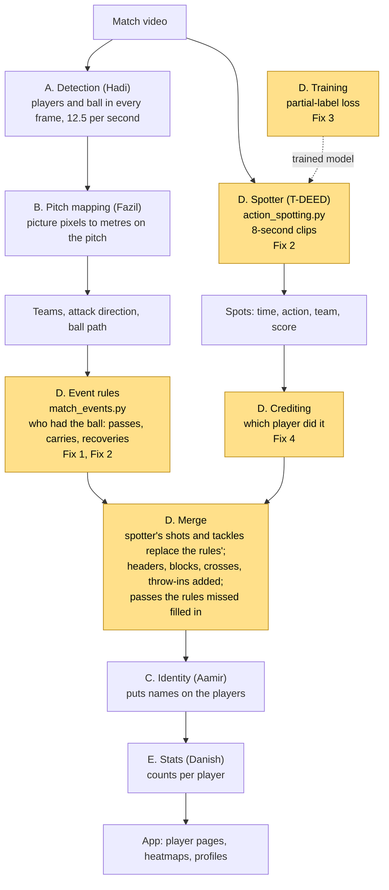
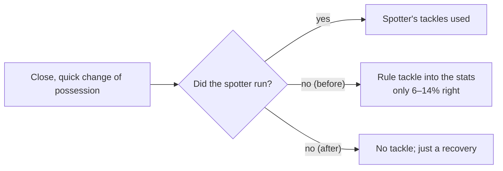
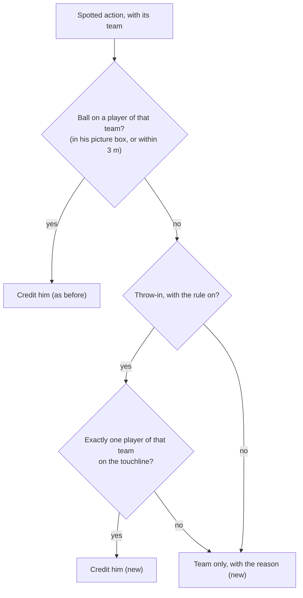

# PitchProfile, Group D (Events)

Owner: Hasif. This branch (`dev-hasif`) holds only the Group D files. The full project is on `main`.

**Where we are (10 Nov).** All four fixes are coded, tested and pushed. What is left is three runs on Hadi's PC to get the numbers, then Hadi merges the code into `main`, and Group D is done. A practice merge onto `main` has already been run: it applies cleanly and all tests still pass (section 6).

## 0. Words you need

| Word | Meaning |
|---|---|
| Event | Something that happened with the ball: pass, carry, shot, tackle, header, throw-in |
| Spotter | The video model (T-DEED). It watches the match and marks the moment each action happens. One mark is a "spot". |
| Crediting | Deciding *which player* did a spotted action |
| Track | One player's path through the video. "Right track" = the right player, even if we don't know his name. |
| Precision / recall | Precision: of what we said happened, how much was right. Recall: of what really happened, how much we found. |
| AP / mAP | One score from 0 to 1 for how well the spotter finds an action type (1 = perfect). mAP = the average over all action types. |
| Held-out games | Games the model never trained on. Used only for testing, so the score is fair. |
| Partial-label loss | Our training trick. A FOOTPASS "Pass" could be a pass, a high pass or a free kick. Instead of forcing one guess, we tell the model "any of these is fine". |
| Ablation | Training once with the trick and once without it, to prove the trick itself helped. |
| Cherry-pick | Copying one commit from this branch onto `main` |

## 1. What Group D does

Group D answers "what happened, and who did it". It takes the players and ball found by Groups A and B, and turns them into events with a player's name on each. Danish (Group E) then counts the events into each player's stats.

There are two parts that work together.

**Event rules** (`match_events.py`) are rules we wrote by hand. They look at where the players and ball are, work out who had the ball, and read the event from where the ball goes next:

| What happens | Event |
|---|---|
| next touch is by a teammate | completed pass |
| next touch is by an opponent | intercepted pass or clearance, then a recovery |
| one player moves the ball 2 m or more | carry |

**The spotter** (`action_spotting.py`) is the trained video model. It catches what positions alone can't show: shots, tackles, blocks, headers, crosses and throw-ins. Each spot is then credited to a player.

**Training** (`spotter_data.py`, `scripts/finetune_action_spotter.py`). We started from the public SoccerNet model and trained it further on SoccerNet BAS and FOOTPASS games, using the partial-label loss for FOOTPASS's vague labels.

## 2. The whole pipeline, start to finish

Yellow boxes are Group D. "Fix 1" to "Fix 4" point to section 4.



In the code (`match_pipeline.analyse`), the steps run in this order:
1. Detection on the video.
2. Spotter on the same video.
3. Pitch mapping and teams.
4. Event rules.
5. Crediting and merge.
6. Identity.
7. Stats.
8. Saved for the app.

## 3. The four fixes at a glance

| Fix | In one line | Before | After | Status |
|---|---|---|---|---|
| 1 | Stop bad tackles leaking into stats | If the spotter didn't run, a tackle rule that is only 6–14% right still fed the stats | That rule never feeds the app | Done |
| 2 | Tidy-ups | One function written twice; one function nobody used | Both cleaned up; nothing behaves differently | Done |
| 3 | Prove the training trick works | We had no proof the partial-label loss itself helped | One command trains with and without it and compares | Code done; Hadi's overnight run |
| 4 | Crediting the right player | 1 in 4 spotted passes and carries gets no player, with no record of why; throw-ins credited worst (6.2%) | Every uncredited action says why; a new throw-in rule is ready | Code done; Hadi's two short runs |

## 4. Each fix in detail

### Fix 1. Bad tackles leaking into the stats (done)

**The problem.** The rules used to call a quick, close change of possession a "tackle": the ball changes team within 0.6 s with the players within 2.2 m. Checked against real labels, that was right only 6–14% of the time, so the team switched tackles over to the spotter. But the switch-over only happened when the spotter ran. If it didn't (no GPU, model missing, crash), the bad rule tackles went straight into the stats.

Think of a smoke alarm that went off wrongly 9 times out of 10. We fitted a better one, but the old one was still wired in as a backup.



| | Before | After |
|---|---|---|
| Rule tackles in the app | yes, whenever the spotter didn't run | never (`TACKLE_RULE = False`) |
| Measuring the rule | `evaluate_events_soccertrack.py` | still works; it switches the rule on just for the measurement |
| App when the spotter ran | spotter tackles | no change |

**Tested by** a new test in `tests/test_match_events.py`. Player B1 takes the ball off A1: no tackle by default, and it doesn't count as a pass either. With the rule switched on, the tackle is still found.

### Fix 2. Tidy-ups (done)

| | Before | After | Why it matters |
|---|---|---|---|
| `available()` in `action_spotting.py` | written twice; Python silently used only the second | one copy, the one that was in use | Looks like a bug in a code review, and a likely Q&A question |
| `contacts()` in `match_events.py` | 46 lines nobody called, with a comment saying it credits spotted actions (not true) | removed; its one useful note kept: classifying tackles from ball contacts was tried and rejected | Dead code with a wrong comment confuses anyone reading it |

Nothing behaves differently. **Tested by** a new test that checks `available()` in three cases, and by all tests still passing after the removal.

### Fix 3. Proving the training trick works (code done, needs Hadi's overnight run)

**Why it matters.** The "Model Development: Excellent" row of the rubric needs a new training strategy, and the partial-label loss is ours. Fine-tuning raised FOOTPASS mAP from 0.478 to 0.604. But that gain could come just from the extra games, not from the trick. The only way to know is to train again *without* the trick and compare.

**What the switch changes.** It changes only how FOOTPASS labels are taught:

| FOOTPASS label | With the trick (ours) | Without (`--hard-labels`) |
|---|---|---|
| Pass | PASS, HIGH PASS or FREE KICK | PASS |
| Cross | CROSS or FREE KICK | CROSS |
| Shot | SHOT or FREE KICK | SHOT |
| Header | HEADER or SHOT | HEADER |
| Frame with no label | nothing, OUT or GOAL | nothing |

`scripts/run_loss_ablation.py` trains both versions with the exact settings of our real model, scores both on held-out games, and writes one table to `evidence/loss_ablation.json`. Both versions are trained fresh, so the only difference between them is the trick. It can never overwrite our real model.

**Result table (filled in after Hadi's run):**

| Model | FOOTPASS mAP | BAS mAP |
|---|---|---|
| Public model, no training | 0.478 | 0.606 |
| Our model (with the trick) | 0.604 | 0.628 |
| Retrained with the trick | waiting | waiting |
| Retrained without the trick | waiting | waiting |

**How to read it.** Compare the two "retrained" rows:
- With the trick ahead by a few hundredths on both sets: the trick works, and that is the claim for the slides.
- Under about 0.01 apart: too close to call with one run each. We say the gain came mostly from the extra data.

**Tested by** checks on the label masks in both modes, checks on the commands the runner builds, and a dry run on the Mac.

### Fix 4. Crediting the right player (code done, needs Hadi's two short runs)

**The problem.** The spotter finds most actions, but picking the player is weak:

| Action | Found | Right named player |
|---|---|---|
| Pass | 90% | 34% |
| Shot | 52% | 17.9% |
| Header | 64% | 9.3% |
| Throw-in | 68% | 6.2% |

Even with perfect names, only 59% of passes land on the right player, and about 1 in 4 spotted passes and carries get no player at all.

**What we planned, and why we changed it.** The plan was to look wider in time and fall back on the player in possession. Hadi had already tested exactly that in September (`DETECTION_RESEARCH.md`, "What limits it now"):
- A wider time window, looser boxes and the possession fallback each gained only 1–3 points, and lost about as much precision.
- His conclusion: better ball detection is what would fix it.

Doing it again would only repeat his result, so fix 4 does two new things instead.

**4a. Every uncredited action now says why.** Before, an uncredited action just had no player. Now it carries one of four reasons:

| Reason | Meaning | Share of the uncredited passes and carries (Hadi, Sept) |
|---|---|---|
| `no ball` | ball not found near that moment | 38% |
| `ball away from players` | ball found, but not on any player of that team | 36% |
| `team not on screen` | no player of that team visible | 22% |
| `no team` | the match's attack direction is unknown, so "left team" can't be matched to a team | rest |

`scripts/credit_reasons.py` adds these up for every action type over all analysed halves, without a GPU. That turns "crediting is weak" into exact numbers per action, which is what the Q&A will ask about.

**4b. A new rule for throw-ins.** At a throw-in the ball is held above the thrower's head. Its spot on the pitch therefore lands metres away from him, and on the far side it lands outside the pitch and gets thrown out. So crediting by the ball fails, which is why throw-ins are the worst-credited action at 6.2%. But the thrower himself is easy to find: by the rules of the game, he stands on or behind the touchline.



| | Before | After |
|---|---|---|
| Throw-in with no ball found | team only | the one player of that team standing within 1.5 m inside or 3 m behind a touchline |
| Two of that team near a touchline | team only | still team only, because we only credit when it's certain |
| Throw-in already credited from the ball | that player | no change; the rule only fills gaps |
| Other actions | no change | no change |

The rule is **switched off until Hadi measures it**. That is how the team adopted every other change: measure first, then switch on.

**Tested by** 8 new tests in `tests/test_spot_credit.py`; there were no crediting tests before:
- crediting by picture and by pitch;
- each of the four reasons;
- the throw-in rule: on and off, the one-player check, not overriding a ball credit, and off by default;
- the counting in `credit_reasons.py`.

**Results (filled in after Hadi's runs):**

| | Rule off (now) | Rule on |
|---|---|---|
| Throw-ins credited to a player | waiting | waiting |
| Throw-ins credited to the right player | waiting | waiting |

Switch the rule on if "right player" goes up and the share right when credited does not drop.

### Not ours: Dispossessed always shows 0 (Danish)

`match_stats.py` lines 198 and 206 count Dispossessed only from the rules. The rules stopped making those events with fix 1, and the spotter's own Dispossessed events were never counted. So it now shows 0 in every case; before fix 1 it was already 0 whenever the spotter ran. Danish has two choices:
- count the spotter's events by dropping `& rules` on those two lines, knowing they are as rough as tackles;
- hide the stat.

## 5. Other improvements: are these four enough?

Yes. Everything else either has already been tried, belongs to someone else, or is a team call:

| Idea | Verdict | Why |
|---|---|---|
| Wider window, looser boxes, possession fallback for crediting | skip | Hadi tested them in Sept: +1–3 points each at the same loss of precision |
| Better tackle detection | skip | Already tried: a tackle-weighted training run moved tackle AP only from 0.06 to 0.08. The public model learned from just 34 tackles. |
| Throw-in *team* from the last touch before the ball went out | free check, no run | `evaluate_spotter_labelled.py` already reports it: in Hadi's report, compare `team_correct` with `team_correct_previous_touch_rule` for throw-ins |
| Faster spotter and a cloud demo (Deployment row) | team decision | Needs Hadi's GPU to measure. The spotter takes about 4.5 min per half now. |
| Dispossessed always 0 | Danish | his file, one-line change (above) |

## 6. What we have checked

| Check | Result |
|---|---|
| Group D tests on the Mac | 28 passed, 1 skipped (needs a GPU) |
| Whole project's tests on the Mac | 145 passed. The 4 that fail need an NVIDIA GPU or Hadi's data files, and failed the same way before these changes. |
| Practice merge onto the latest `main` | All 7 code commits apply with no conflicts; same test results |
| Spotter on held-out games | mAP 0.478 → 0.604 (FOOTPASS), 0.606 → 0.628 (BAS) |
| Spotter, passes and carries | AP about 0.9 |
| Spotter, tackles | AP 0.06–0.10 (weak; data limit) |
| Shots on held-out games | precision 0.68, recall 0.74 |
| Event rules with perfect positions (SoccerTrack) | passes: precision 0.69, recall 0.70 |
| Passes per player against the true counts | correlation r = 0.89 |
| Still to come | fix 3 table and fix 4 throw-in numbers, from Hadi's runs |

## 7. Steps to finish

| Step | What | Who | Status |
|---|---|---|---|
| 1 | Branch and baseline commit | Hasif | Done |
| 2 | Fix 1, fix 2 | Hasif | Done |
| 3 | Fix 3 code | Hasif | Done |
| 4 | Fix 4 code (4a and 4b) | Hasif | Done |
| 5 | Practice merge onto `main` | Hasif | Done: clean |
| 6 | Message Hadi (the runs in section 8) and Danish (Dispossessed) | Hasif | **To do** |
| 7 | Hadi makes branch `hasif-groupd` with the 7 code commits and runs the tests | Hadi | Waiting |
| 8 | Overnight: training comparison (fix 3) | Hadi's PC | Waiting |
| 9 | Short, no GPU: crediting reasons and the throw-in rule (fix 4) | Hadi's PC | Waiting |
| 10 | Fill the result tables in sections 4 and 6; switch the throw-in rule on if it won | Hasif | After 8 and 9 |
| 11 | Final commit and push | Hasif | After 10 |
| 12 | Hadi merges `hasif-groupd` into `main`, runs all tests and one match in the app | Hadi | End |
| **Done** | **Group D code finished** | | |
| 13 | Slides, poster box, demo minute, Q&A, backup video | Hasif | 18–20 Nov |

Week 13 submission is about 23–27 Nov; check the date on xSITe.

## 8. Commands

**Tests on the Mac (no GPU):**

```zsh
cd PitchProfile
.venv/bin/python -m pytest -q tests/test_spot_credit.py tests/test_spot_actions.py tests/test_spotter_data.py tests/test_match_events.py tests/test_loss_ablation.py
```

**On Hadi's PC, steps 7–9.** He takes the code commits only, not the README ones, because `main` keeps its own README. The short checks run first, and the overnight training last:

```
git fetch origin
git switch -c hasif-groupd origin/main
git cherry-pick 24b34ab f50f8ec 8da14ad e62fa33 5f956d2 dc4f878 cbc0c1a
cd PitchProfile
.\.venv\Scripts\python.exe -m pytest -q
.\.venv\Scripts\python.exe scripts\credit_reasons.py --footpass
.\.venv\Scripts\python.exe scripts\measure_shot_credit.py throwinline
.\.venv\Scripts\python.exe scripts\measure_shot_credit.py current
.\.venv\Scripts\python.exe scripts\run_loss_ablation.py --dry-run
.\.venv\Scripts\python.exe scripts\run_loss_ablation.py
```

| Command | Takes | Sends back |
|---|---|---|
| `credit_reasons.py --footpass` | minutes, no GPU | `evidence/credit_reasons.json` |
| `measure_shot_credit.py throwinline`, then `current` | no GPU; `current` must run second, as it puts the data back | `evidence/identity_footpass_variant_throwinline.json` and `..._current.json` |
| `run_loss_ablation.py` | about 7–8 h, GPU (leave overnight) | `evidence/loss_ablation.json` |

**Step 12, the final merge on Hadi's PC.** If step 10 added a code commit (switching the throw-in rule on), Hadi cherry-picks it onto `hasif-groupd` first.

```
git switch main
git merge hasif-groupd
cd PitchProfile
.\.venv\Scripts\python.exe -m pytest -q
```

Then he analyses one match in the app and checks that the event counts look normal. The commits keep Hasif as author.

## 9. Commits on this branch

| Commit | What |
|---|---|
| `c084508` | Baseline: the Group D files as they were on 5 Nov |
| `24b34ab` | Fix 2: remove the duplicate `available()` |
| `f50f8ec` | Fix 1: keep the rejected tackle rule out of the stats |
| `8da14ad` | Fix 3: switch to train without the trick |
| `e62fa33` | Fix 3: one-command training comparison |
| `5f956d2` | Fix 2: remove the unused `contacts()` |
| `dc4f878` | Fix 4a: record why a spotted action has no player |
| `cbc0c1a` | Fix 4b: throw-in touchline rule, off until measured |
| README commits | These notes (not copied to `main`) |
